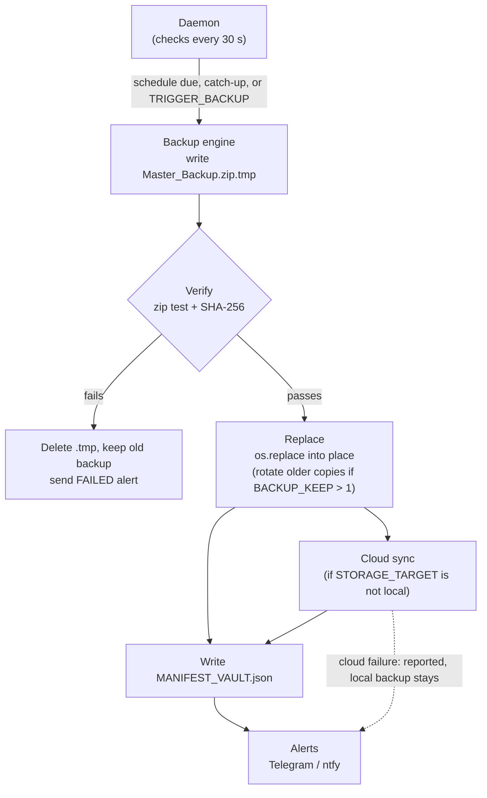

# ProjectVault Architecture

How the pieces fit together. Read this if you want to understand, debug or change ProjectVault.

## Parts

| File | Role |
|---|---|
| `vault_daemon.py` | Long-running background process. Decides when to back up. |
| `vault_backup.py` | The backup engine, alerts, and the command-line flags (`--status`, `--verify`, ...). |
| `vault_restore.py` | Rebuilds a project from an archive. |
| `gdrive_sync.py` | Optional Google Drive copy (API or desktop folder). |
| `s3_sync.py` | Optional S3-compatible copy (beta). |
| `install_service_*` / `uninstall_service_*` | Register or remove the daemon as a per-user service. |
| `backups/` | Output: `Master_Backup.zip`, `MANIFEST_VAULT.json`, `vault_daemon.log`. |
| `.env` | Your settings. |

## Backup flow

## Backup lifecycle

1. The daemon (or you, running `python vault_backup.py`) starts a backup.
2. The engine walks the workspace and skips excluded folders, file types and secrets (see the README for the full list, plus `BACKUP_EXCLUDE` and `.vaultignore`).
3. It writes the files into `backups/Master_Backup.zip.tmp`.
4. It verifies the temporary file: the zip must pass its integrity test and contain the expected number of entries; then a SHA-256 is computed. Only one backup can run at a time (an OS file lock on `backups/.vault_backup.lock`); a second one exits without touching anything.
5. Only then is the temporary file moved over `Master_Backup.zip` with `os.replace`. The old archive is never deleted before the new one is verified and in place.
6. If `BACKUP_KEEP` is greater than 1, older archives are shifted to `Master_Backup.1.zip`, `Master_Backup.2.zip`, and so on, after the new one is verified. The oldest beyond the limit is removed. Cleanup only touches `Master_Backup*.zip` and `.tmp` files inside `backups/`.
7. The manifest `backups/MANIFEST_VAULT.json` is written with `version`, `last_backup_at`, `last_backup_str`, `archive_file`, `size_mb`, `size_bytes`, `file_count`, `skipped_files`, `sha256`, `archives` (archive file name to SHA-256, one entry per kept version), `reason`, `elapsed_seconds` and `cloud`.
8. An alert is sent if Telegram or ntfy is configured. Alerts are plain text. Symbolic links are not followed, and unreadable files are skipped and counted in `skipped_files`.

## Schedule and catch-up

- `BACKUP_SCHEDULE_HOUR` (default `02:00`, local time, `HH:MM`) is the daily time.
- A workspace with no manifest (never backed up) gets its first backup immediately, without waiting for the scheduled time.
- Every 30 seconds the daemon asks: has today's scheduled time passed, and has no backup run today? Today's state comes from `last_backup_at` in the manifest. If so, it runs one.
- This means a computer that was off or asleep at 02:00 gets its backup soon after the daemon is running again, not a day later.
- Creating a file named `TRIGGER_BACKUP` in the workspace requests an immediate backup. The daemon deletes the file and runs it. The file is never archived.
- A second daemon will not start: the first one holds a local port (`VAULT_DAEMON_PORT`, default 58745, on 127.0.0.1).
- If a scheduled backup fails, you get one failure alert for that episode, and the daemon retries every 30 minutes (silently) until one succeeds. A failed on-demand backup always sends an alert.
- The daemon log is `backups/vault_daemon.log`. It rotates at about 1 MB and keeps one old file.

## Cloud sync

- Cloud sync runs only after a local backup has been verified and put in place.
- `STORAGE_TARGET` picks the cloud: `gdrive`, `s3`, or `both` (every configured cloud).
- Google Drive: either the API with a service account, or copying into a folder synced by the Drive desktop app (`GDRIVE_LOCAL_PATH`).
- S3: uses `boto3` and uploads `Master_Backup.zip` under the same key each time (with an optional `S3_KEY_PREFIX`).
- A cloud failure does not fail the local backup. The result is stored under `cloud` in the manifest and mentioned in the alert.
- Optional libraries are imported only when needed. A clear error is shown if one is missing.

## Restore

1. `vault_restore.py` picks the archive: `--archive PATH`, otherwise the one in `backups/`.
2. It tests the zip, and if a manifest beside the archive records a SHA-256 for it, checks that too. A mismatch stops the restore.
3. It checks every entry path and rejects any that would land outside the destination folder (zip-slip).
4. With `--dry-run` it only lists what it would do.
5. It compares every entry with what is already in `--dest` (default: the workspace). Identical files are skipped. If any existing file differs, the restore aborts before writing anything and lists the conflicts, unless you pass `--force`. Differing ProjectVault scripts in the root are kept unless `--force`. Restored files never get group/world write permission.

## Design choices

- Standard library only for the core, so it runs anywhere Python 3.9+ runs.
- Flat layout: scripts sit in the project root so you can copy them in.
- Verify before replace: a bad run cannot destroy a good backup.
- Secrets excluded by default: the zip is not encrypted, so the safe default is to leave them out.
