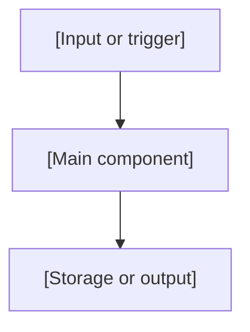

# Architecture

Copy this file to `docs/ARCHITECTURE.md` and fill it in. Update it when the structure changes.

**Project:** [name] | **Last updated:** [YYYY-MM-DD]

## 1. Overview

[Two or three sentences: the main parts and how they connect.]

Replace the boxes above with your real components.

## 2. Folders and files

| Path | What it does |
|---|---|
| `[path]` | [role] |
| `[path]` | [role] |
| `docs/` | Project documentation |
| `backups/` | ProjectVault output (do not edit) |

## 3. Data and state

- **Where data lives:** [database, files, ...]
- **What must never be lost:** [items]
- **What can be rebuilt:** [items]

## 4. External services

| Service | Used for | Where its keys are kept |
|---|---|---|
| [service] | [purpose] | `.env` (not committed) |

## 5. Known weak spots

- [thing that might break, and why]
